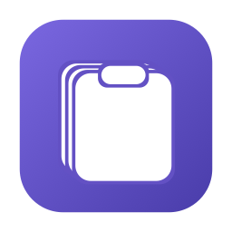

# Snapspool

**スクリーンショットもテキストも履歴に残る、macOS用のクリップボード履歴アプリ。**

コピーしたものを後から選んで貼り直せます。Windowsのクリップボード履歴（`Windows+V`）と
同じ体験をmacOSで実現することを目指して作りました。

> 現在 **App Store への申請を準備中**です。それまではソースからビルドして使えます。

---

## できること

- **画像とテキストを1つの履歴にためる** — スクリーンショットも、コピーした画像も、テキストも
- **選んだらそのまま貼り付け** — `Cmd+Shift+V` で履歴を開き、選ぶと前面のアプリに貼り付きます
- **画像はファイルとしても残る** — 指定フォルダにPNGで自動保存。履歴から溢れても手元に残ります
- **画像とテキストで別々の上限** — テキストを何度コピーしても、スクリーンショットが押し出されません
- **外に出ない** — ネットワーク通信なし、解析なし、広告なし。テキスト履歴は終了時に消えます

## 覚えるショートカット

アプリ専用のキーは**1つだけ**です。残りはmacOS標準のまま変わりません。

| 操作 | キー |
|---|---|
| コピー | `Cmd+C`（macOS標準） |
| 貼り付け（最新） | `Cmd+V`（macOS標準） |
| **履歴から貼り付け** | **`Cmd+Shift+V`**（設定で変更可） |

## 使い始める前に（重要）

Snapspoolは**クリップボードに入ったものだけ**を扱います。macOSのスクリーンショットは
初期設定だと「ファイルに保存」されてクリップボードを経由しないため、そのままでは拾えません。

**システム設定 > キーボード > キーボードショートカット > スクリーンショット** を開き、
「**ピクチャをクリップボードにコピー**」側のショートカットを有効にしてください。

普段使っているキーをそのまま「クリップボードにコピー」側へ付け替えれば、
**操作を変えずに**Snapspoolが拾えるようになります。初回起動時にも同じ案内を表示します。

> ファイルとしても残したい場合は心配いりません。クリップボードに入った画像は
> Snapspoolが指定フォルダへPNGで保存します。保存先は設定で変更できるので、
> 今まで使っていたスクリーンショット用フォルダを指定すれば置き場所は変わりません。

## 動作環境

- macOS 15.0 以降
- Apple Silicon / Intel

## インストール

### App Store（準備中）

申請準備中です。公開されたらここにリンクを追加します。

### ソースからビルド

[XcodeGen](https://github.com/yonaskolb/XcodeGen) が必要です。

```bash
brew install xcodegen
git clone https://github.com/Woodpecker-50883/Snapspool.git
cd Snapspool
xcodegen generate --spec xcodegen.yml
xcodebuild build -scheme Snapspool -destination 'platform=macOS' \
  -derivedDataPath build/DerivedData -quiet
open build/DerivedData/Build/Products/Debug/Snapspool.app
```

常駐させて使うアプリなので、**システム設定 > 一般 > ログイン項目**への登録をおすすめします。

## プライバシー

**収集も送信も一切しません。** ネットワーク通信を行わず、解析も広告もトラッキングもありません。

- 画像: 指定フォルダにPNGで保存（既定は `~/Pictures/Snapspool/`）
- テキスト: アプリ起動中のみメモリに保持し、**終了時に消去**。ディスクに書きません
- パスワードマネージャが秘匿指定してコピーした内容は、履歴にもファイルにも残しません
- ファイル・フォルダのコピーは素通りさせ、記録しません

詳細は [プライバシーポリシー](docs/privacy-policy.md) をご覧ください。

## 不具合・要望

[Issues](https://github.com/Woodpecker-50883/Snapspool/issues) へお願いします。

## ライセンス

[MIT License](LICENSE) — Copyright (c) 2026 Woodpecker-50883

## 謝辞

設計の参考にしました。

- [Maccy](https://github.com/p0deje/Maccy) — クリップボード監視と自動貼り付けの実装
- [Clipy](https://github.com/Clipy/Clipy) — 開発のきっかけになったアプリ

---

## English

**Snapspool** is a clipboard history app for macOS that keeps **images and screenshots**,
not just text. Press `Cmd+Shift+V` to pick something you copied earlier and it is pasted
for you. Images are also saved as PNG files to a folder you choose, so they survive
after dropping out of the history.

No network connections, no analytics, no tracking. Text history lives only in memory
and is discarded when you quit. Requires macOS 15.0 or later.

To let Snapspool see your screenshots, enable the macOS shortcut for
**copying screenshots to the clipboard** (System Settings > Keyboard > Keyboard Shortcuts
> Screenshots). Assign the key you already use to that side and your habits keep working.
